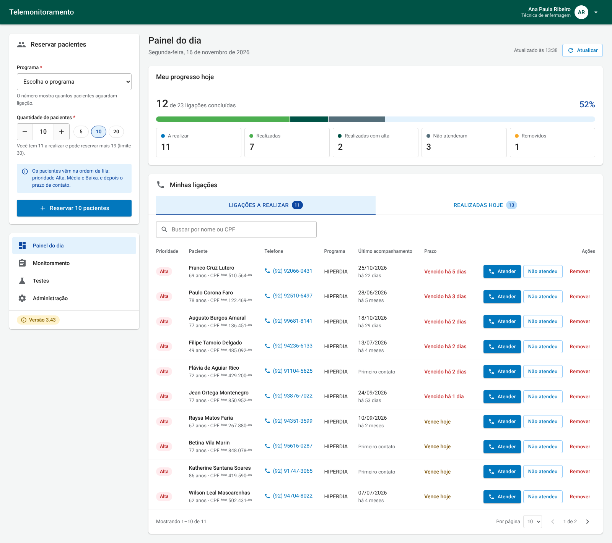

# Telemonitoramento: Painel do dia

Nova versão da tela de **Reserva de Pacientes** do sistema de telemonitoramento, em **Laravel 13 + Vue 3**.
Mantém a paleta e o estilo Material da versão atual (cabeçalho verde `#005346`, azul `#0277BD`,
abas `#0D47A1`/`#E3F2FD`). A prioridade foi a experiência de quem faz as ligações o dia inteiro.



## O que mudou e por quê

| Problema na versão atual | Como ficou |
|---|---|
| A "Barra de Progresso do Dia" mostrava **99,69% em vermelho** porque misturava a fila geral (23.444 sem reserva) com o trabalho do operador. Vermelho passava a ideia de erro. | **"Meu progresso hoje"** mostra só as ligações do operador: *13 de 23 concluídas (57%)*. A fila do programa aparece no seletor de programa, onde ajuda na decisão. |
| Legenda com dois verdes iguais (Realizadas e Realizadas com alta) e preto para "não atendidas". | Cores distintas, também na luminosidade: verde, verde institucional, cinza-azulado e âmbar. Cada item da legenda é um botão que filtra a lista. |
| Dois blocos com o mesmo título "Reserva de Pacientes" (o formulário e a lista). | **"Reservar pacientes"** (ação) e **"Minhas ligações"** (trabalho do dia). |
| Painel "Atendimentos do Dia" recolhido, com ícone ≡ que parece menu. | Juntado à aba **"Realizadas hoje"**, com resultado, horário e filtros. |
| Lista vazia mostrava "Mostrando de a de 0 Registros". | Estado vazio que explica o próximo passo, com botão que leva ao formulário. Paginação "Mostrando 1–10 de 23". |
| Reserva aleatória ("Quero pacientes!" com ícone de embaralhar) e quantidade digitada livremente. | Fila ordenada por **prioridade → prazo → tempo sem contato**. Quantidade com botões −/+ e atalhos 5/10/20. O botão diz o que faz: "Reservar 10 pacientes". Limite de ligações abertas por operador. |
| Tabela sem prioridade nem prazo; CPF completo na tela. | Colunas **Prioridade** e **Prazo** ("Vencido há 3 dias"); CPF mascarado (`***.456.789-**`); telefone clicável. |
| Não havia ações na linha nem como corrigir um engano. | **Atender**, **Não atendeu** e **Remover** (com motivo obrigatório) em cada linha, e **Desfazer** por 10 minutos. |
| Menu principal escondido abaixo do aviso de versão; item "Testes" visível em produção. | Menu com item ativo destacado; versão como selo discreto; "Testes" só em `local`/`staging`. Em telas estreitas, o menu vira gaveta. |
| Nome do usuário em minúsculas, sem perfil nem "Sair" visível. | Nome formatado, perfil e menu com "Sair do sistema". |

Também foram tratados: acessibilidade (rótulos, `aria-*`, foco visível, navegação por teclado nas abas, diálogo nativo
`<dialog>`), mensagens de erro em português, atualização ao voltar para a aba do navegador e layout em celular
(a tabela vira cartões).

Mais capturas em [`docs/capturas`](docs/capturas).

## Como rodar localmente

Pré-requisitos: PHP 8.3+, Composer e Node 20+.

```bash
composer install
cp .env.example .env
php artisan key:generate
touch database/database.sqlite
php artisan migrate --seed
npm install
npm run build
php artisan serve
```

Abra `http://localhost:8000/login`. Em `APP_ENV=local` essa rota entra direto com o operador de demonstração.
Os dados do seeder são **fictícios**.

Testes: `php artisan test`.

## Integração com o sistema atual

Este projeto é uma base pronta para encaixar no sistema existente. Pontos a ajustar:

1. **Autenticação**: remova a rota `/login` de demonstração em `routes/web.php` e use o login atual (a rota precisa se chamar `login`).
2. **Tabelas**: os modelos `Programa`, `Paciente` e `Reserva` assumem as colunas das migrations em `database/migrations/2026_11_16_*`. Ajuste `$table`/colunas nos modelos ou crie *views* no banco para mapear o esquema real.
3. **Atendimento**: o botão "Atender" abre `/atendimentos/{reserva}`. Troque `resources/views/atendimento.blade.php` pelo formulário SOAP já usado, chamando `ReservaService::registrarResultado()` ao salvar.
4. **Concorrência**: em MySQL 8 / PostgreSQL a reserva usa `FOR UPDATE SKIP LOCKED`, então dois operadores nunca recebem o mesmo paciente.
5. **Parâmetros** em `config/telemonitoramento.php`: versão, logo do cabeçalho, limite de reservas, atalhos de quantidade, motivos de remoção, itens do menu.

## Estrutura

```
app/
  Enums/                StatusReserva, Prioridade
  Http/Controllers/     PainelController (página), AtendimentoController
  Http/Controllers/Api/ PainelController (resumo, programas), ReservaController
  Http/Requests/        validações com mensagens em português
  Http/Resources/       ReservaResource (mascara CPF, formata telefone)
  Policies/             ReservaPolicy (só o dono da reserva altera)
  Services/             ReservaService (regras de reserva, resultado, desfazer, resumo)
resources/
  css/painel.css        tokens da paleta e componentes
  js/painel/            PainelApp.vue + componentes (Cabeçalho, CardReserva, ProgressoDia,
                        ListaLigacoes, DialogoRemover, MenuLateral, Icone)
tests/Feature/ReservaTest.php
```
